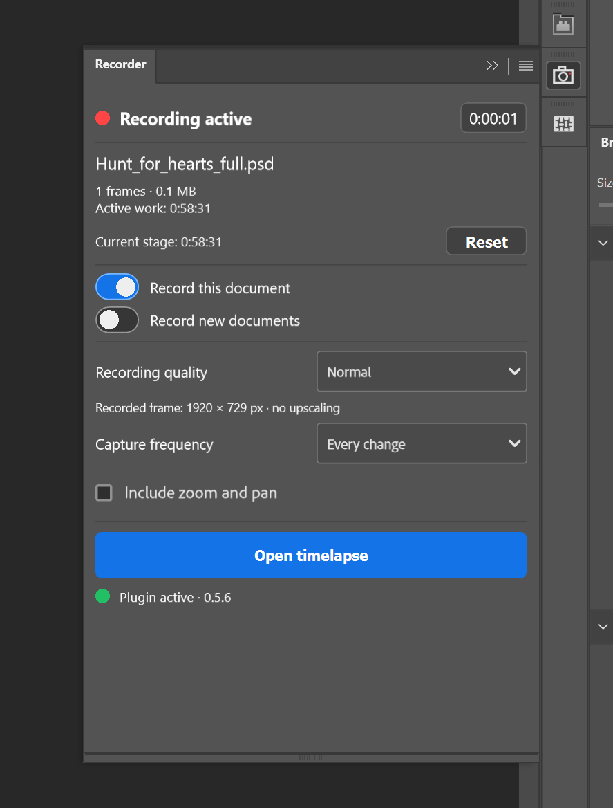
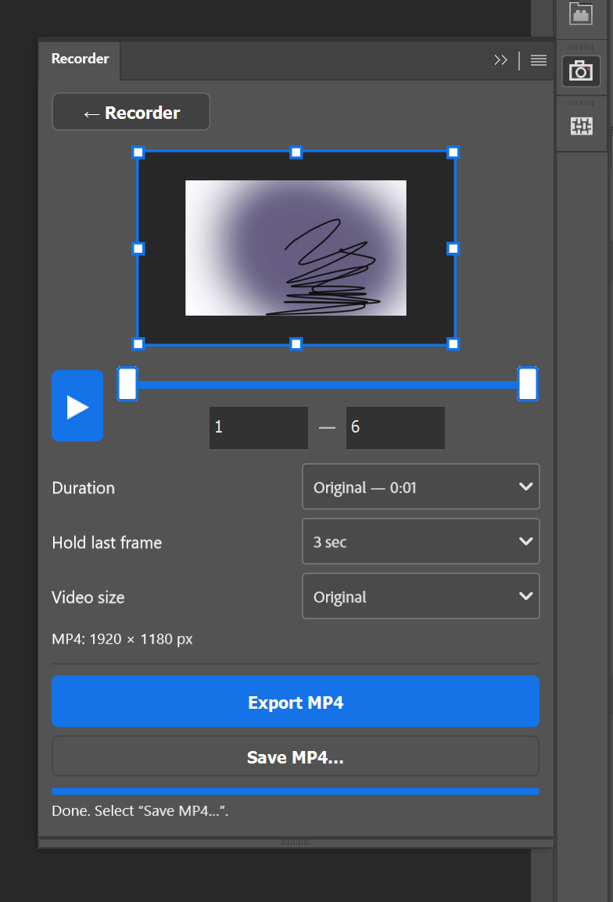

# PScreenRec — Photoshop Timelapse Recorder

[English](README.md) · [Русский](README.ru.md)

**A free Photoshop plugin for recording drawing timelapses in Photoshop.**

PScreenRec captures your drawing process much like Procreate and Clip Studio Paint: it takes snapshots of the canvas as you make changes and turns them into a timelapse. No need to set up OBS or other screen recording software! Photoshop panels and the cursor stay out of the recording.

Export your timelapse as MP4. Recordings stay on your computer.

## Download

| Platform | Installer | Version | Requirements |
| --- | --- | --- | --- |
| Windows | **[Download for Windows](https://github.com/JazzyXP/PScreenRec/releases/download/v0.5.9/PScreenRec-0.5.9-Setup.exe)** | 0.5.9 | Windows 10 / 11, x64 |
| Mac | **[Download for Mac](https://github.com/JazzyXP/PScreenRec/releases/download/mac-v0.5.13/ProcessRecorder-0.5.10-Mac-arm64-Standalone-Experimental.dmg)** | 0.5.10 | macOS 15+, Apple Silicon |

Download one installer for your computer. It includes the plugin and its local helper; a separate Python installation is not needed. Installation instructions for both platforms are below.

[What is new in Windows 0.5.9](CHANGELOG.md#windows-059)

### Interface

<table><tr><th>Recording</th><th>Timelapse and export</th></tr><tr><td></td><td></td></tr></table>

### Video examples

[Watch a timelapse — MP4](https://github.com/JazzyXP/PScreenRec/raw/refs/heads/main/assets/timelapse-example.mp4)

## Features

- **Keep adding to the same timelapse across sessions:** close a saved document, reopen it later, or rename it and continue the existing recording.
- Separate recording control for each document, with an option to automatically record new documents.
- Capture every detected change, or every 2nd, 5th or 10th change.
- Record the full canvas or the visible canvas area at the current zoom and pan position.
- Choose recording quality without upscaling small canvases.
- Active work time and a resettable stage timer.
- Timelapse preview in the panel, frame range selection and cropping.
- MP4 export at the original 10 fps timing or a target duration of 15, 30 or 60 seconds.
- Adjustable hold time for the final frame.
- Interface language selected automatically from Photoshop’s language.

## One recording for the whole project

Save your drawing as a PSD or PSB after starting the recording. You can then close, rename and reopen the file — new frames will be added to the same timelapse.

You can hide the plugin panel without affecting the recording.

## Installation

### Windows

1. Save your drawings and close Photoshop.
2. Run the downloaded EXE and follow the prompts.
3. Open Photoshop → **Plugins → PScreenRec → PScreenRec**.
4. Enable **Record this document**. To automatically record future new files, enable **Record new documents**.

Creative Cloud, Python and UXP Developer Tool do not need to be installed separately. Internet access is needed for the initial FFmpeg download. The installer offers English, Russian, German, French, Spanish, Brazilian Portuguese and Ukrainian; the panel uses English or Russian according to Photoshop.

### Mac

1. Save your drawings and quit Photoshop.
2. Open the downloaded DMG, run the Install application inside and follow the prompts.
3. If macOS blocks this unsigned installer, use **System Settings → Privacy & Security → Open Anyway** for this application. See the [Mac installation guide](MAC_INSTALL.md) for the exact steps and Input Monitoring permission.
4. Open Photoshop → **Plugins → PScreenRec → PScreenRec** and enable **Record this document**.

The main Mac download installs the plugin and helper directly. Python and FFmpeg are included. No Homebrew or UXP Developer Tool is needed.

Alternative Mac installer: through Creative Cloud

[Download the Mac installer for Creative Cloud](https://github.com/JazzyXP/PScreenRec/releases/download/mac-v0.5.13/ProcessRecorder-0.5.10-Mac-arm64-Adobe-CC.dmg). Choose this option if you prefer Adobe's installation mechanism; it requires Creative Cloud Desktop. It installs the same independent plugin and helper. Use one Mac installer, not both.

## Recording quality

| Quality | Maximum long edge |
| --- | --- |
| Normal | 1920 px |
| High | 3840 px |
| Original | Canvas size within supported capture limits |

Aspect ratio is preserved and small canvases are not upscaled. The panel displays the actual recorded frame dimensions. Quality changes apply to future frames.

**High is recommended for large canvases.** Original-size capture can put more load on Photoshop and briefly show a busy cursor. High reduces the workload; it does not change previously recorded frames.

## Export

Open **Timelapse**, choose the frame range, crop, duration and video size, then click **Export MP4** and choose a destination in the system save dialog.

## Thank the developer

PScreenRec is free. If you find it useful, you can [leave a tip](https://app.lava.top/dnso?tabId=about).

## Availability and limitations

Windows: version 0.5.9, Photoshop 2024 (25.0) or later. Mac: installers 0.5.10 for Apple Silicon and macOS 15+. Intel has not been tested. The direct Mac installer does not invoke CC, but recording with CC completely absent has not been verified. Mac installers are unsigned and not notarized.

The plugin captures canvas states rather than every individual Photoshop action. Several rapid changes may be combined into one frame. Some Photoshop versions may briefly change the cursor during capture. Original-size recording of large canvases requires more processing time and disk space.

## Report a problem

[Open an issue](https://github.com/JazzyXP/PScreenRec/issues/new).

Include your Photoshop and operating system versions (Windows or macOS), canvas dimensions, recording quality and steps to reproduce. Remove private information from screenshots before sharing them.

[Privacy](PRIVACY.md) · [Use information](TERMS.md) · [Third-party components](THIRD_PARTY.md)

 
