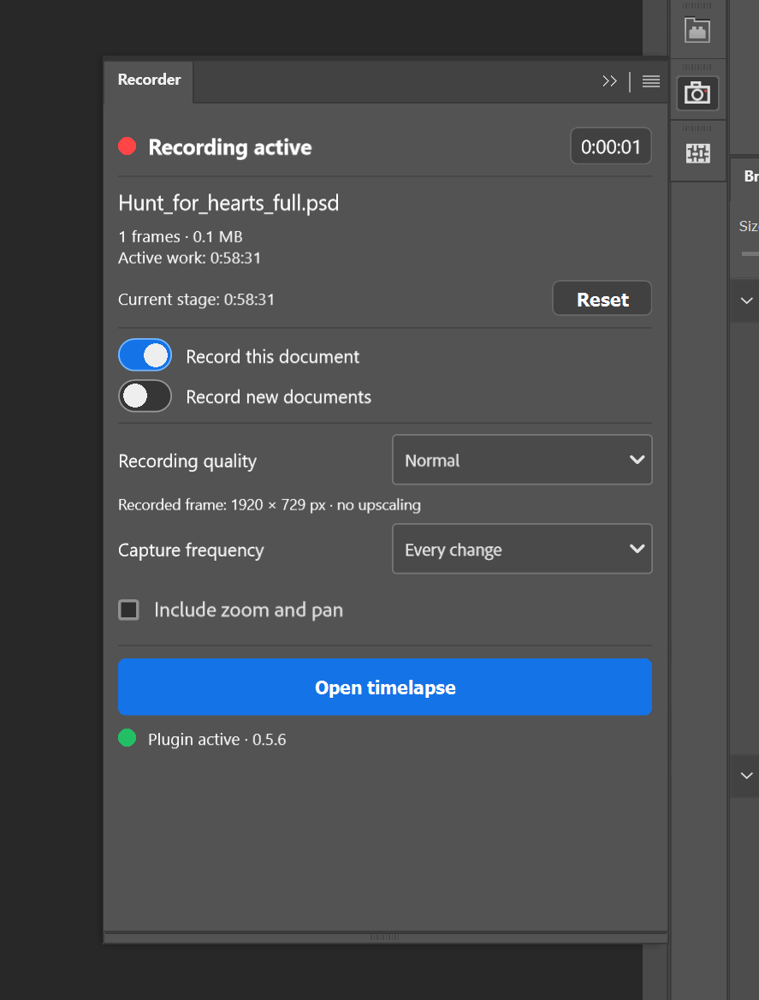
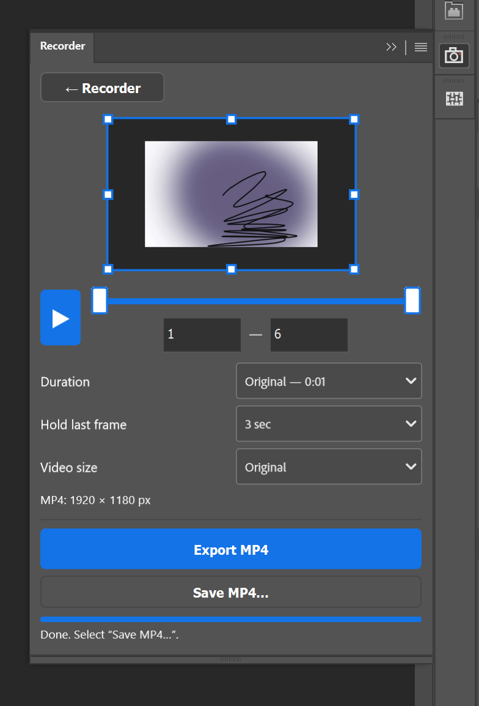

# PScreenRec

[English](README.md) · [Русский](README.ru.md)

  

**Timelapses in Photoshop.**

PScreenRec captures canvas changes without Photoshop panels and exports them as MP4. Recordings stay on your computer.

### Download for Windows

**[Download installer 0.5.6 — no Creative Cloud required](https://github.com/JazzyXP/PScreenRec/raw/refs/heads/main/downloads/PScreenRec-0.5.6-Setup.exe)** · [SHA-256](downloads/PScreenRec-0.5.6-Setup.exe.sha256)

[Thank the developer](https://app.lava.top/dnso?tabId=about)

Windows x64 · Python included · revision 24.

### Interface

<table><tr><th>Recording</th><th>Timelapse and export</th></tr><tr><td></td><td></td></tr></table>

### Video examples

[Watch a timelapse — MP4](https://github.com/JazzyXP/PScreenRec/raw/refs/heads/main/assets/timelapse-example.mp4)

## Features

- **Keep adding to the same timelapse across sessions:** close a saved document, reopen it later, or rename it and continue the existing recording.
- Separate recording control for each document, with an option to automatically record new documents.
- Capture every detected change, or every 2nd, 5th or 10th change.
- Record the full canvas or the visible canvas area at the current zoom and pan position.
- Choose recording quality without upscaling small canvases.
- Active work time and a resettable stage timer.
- Timelapse preview in the panel, frame range selection and cropping.
- MP4 export at the original 10 fps timing or a target duration of 15, 30 or 60 seconds.
- Adjustable hold time for the final frame.
- Interface language selected automatically from Photoshop’s language.

## Continue a project later

After first using the recorder, **save your document as PSD or PSB** so its recording ID is stored in the file's metadata. Reopening or renaming that file keeps the link to the same local timelapse. Keep the recording data folder: the document stores the link, not all the recorded frames.

Closing or hiding the plugin panel does not stop recording while Photoshop and the document remain open. Closing the document or Photoshop stops capture; when you reopen the saved document, recording can continue into the same timelapse if recording is enabled for it.

## Windows installation

The installer selects a default language from Windows: English, Russian, German, French, Spanish, Brazilian Portuguese or Ukrainian. You can change it at startup. Other system languages default to English. The plugin panel still follows the Photoshop language (Russian or English).

1. Save your drawings and close Photoshop.
2. Run the PScreenRec installer and follow the prompts.
3. Open Photoshop → **Plugins → PScreenRec → PScreenRec**.
4. Enable **Record this document** for the current drawing. Enable **Record new documents** to record subsequently created files.

The installer without Creative Cloud includes Python. You do not need to install Creative Cloud, Python or UXP Developer Tool separately. An internet connection is required for the initial FFmpeg download.

## Recording quality

| Quality | Maximum long edge |
| --- | --- |
| Normal | 1920 px |
| High | 3840 px |
| Original | Canvas size within supported capture limits |

Aspect ratio is preserved and small canvases are not upscaled. The panel displays the actual recorded frame dimensions. Quality changes apply to future frames.

**High is recommended for large canvases.** Original-size capture can put more load on Photoshop and briefly show a busy cursor. High reduces the workload; it does not change previously recorded frames.

## Export

Open **Timelapse**, choose the frame range, crop, duration and video size, then click **Export MP4** and choose a destination in the system save dialog.

## Availability and limitations

The current build is for Windows. A macOS release is not ready yet.

The plugin captures canvas states rather than every individual Photoshop action. Several rapid changes may be combined into one frame. Some Photoshop versions may briefly change the cursor during capture. Original-size recording of large canvases requires more processing time and disk space.

## Report a problem

[Open an issue](https://github.com/JazzyXP/PScreenRec/issues/new).

Include your Photoshop and Windows versions, canvas dimensions, recording quality and steps to reproduce. Remove private information from screenshots before sharing them.

[Privacy](PRIVACY.md) · [Use information](TERMS.md) · [Third-party components](THIRD_PARTY.md)
