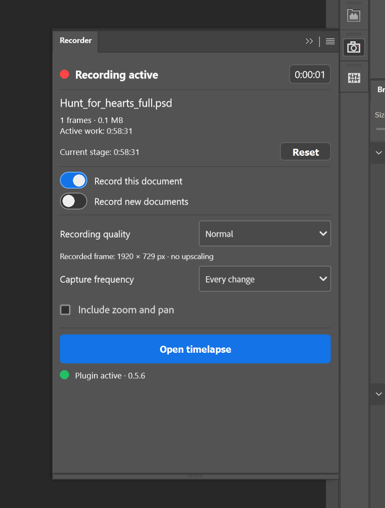
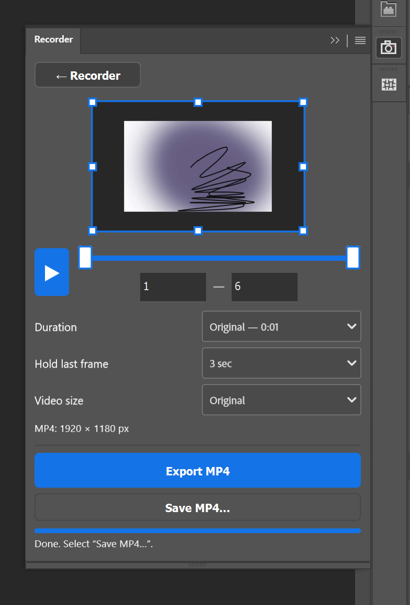

# PScreenRec

[Русский](README.md) · [English](README.en.md)

  

**Таймлапсы в Photoshop.**

PScreenRec сохраняет изменения холста без панелей Photoshop и собирает из них MP4. Записи хранятся на вашем компьютере.

### Скачать для Windows

**[Скачать установщик 0.5.6 — без Creative Cloud](https://github.com/JazzyXP/PScreenRec/raw/refs/heads/main/downloads/PScreenRec-0.5.6-Setup.exe)** · [Поблагодарить разработчика](https://app.lava.top/dnso?tabId=donate) · [SHA-256](downloads/PScreenRec-0.5.6-Setup.exe.sha256)

Windows x64 · Python включён · ревизия 20.

### Интерфейс

<table><tr><th>Запись</th><th>Таймлапс и экспорт</th></tr><tr><td></td><td></td></tr></table>

### Примеры видео

[Рыцарь и комар — посмотреть MP4](https://github.com/JazzyXP/PScreenRec/raw/refs/heads/main/assets/knight-and-mosquito.mp4) · [Ещё один пример — посмотреть MP4](https://github.com/JazzyXP/PScreenRec/raw/refs/heads/main/assets/timelapse-example.mp4)

## Что умеет

- Включать запись отдельно для каждого документа и запоминать выбор для новых файлов.
- Записывать весь холст независимо от масштаба просмотра или учитывать зум и перемещение.
- Выбирать качество и частоту захвата изменений.
- Показывать активное время работы и отдельный таймер этапа со сбросом.
- Просматривать таймлапс в панели: выбирать начало и конец, обрезать изображение и сохранять пропорции.
- Экспортировать MP4 исходной длительности при 10 кадрах/с либо на 15, 30 или 60 секунд, с задержкой последнего кадра.
- Автоматически выбирать интерфейс по языку Photoshop.

## Установка на Windows

Язык установщика выбирается по языку Windows. Доступны русский, английский, немецкий, французский, испанский, португальский (Бразилия) и украинский; язык можно изменить при запуске. Для остальных систем по умолчанию используется английский. Язык панели плагина по-прежнему определяется языком Photoshop (русский или английский).

1. Сохраните рисунки и закройте Photoshop.
2. Запустите установщик PScreenRec и следуйте подсказкам.
3. Откройте Photoshop → **Plugins → PScreenRec → PScreenRec**.
4. Включите **«Записывать этот документ»** для открытого рисунка. Чтобы записывать следующие новые файлы, включите **«Записывать новые документы»**.

Для установщика без Creative Cloud отдельно устанавливать Creative Cloud, Python или UXP Developer Tool не нужно. Для первоначальной загрузки FFmpeg требуется интернет.

## Какое качество выбрать

| Качество | Максимальная длинная сторона кадра |
| --- | --- |
| Обычное / Normal | 1920 px |
| Высокое / High | 3840 px |
| Исходное / Original | Размер холста в пределах поддерживаемого захвата |

Пропорции сохраняются, маленькие изображения не увеличиваются. Фактический размер кадра показан под списком. Изменение качества влияет на будущие кадры.

**Для больших холстов рекомендуем High.** Захват исходного размера может заметно нагружать Photoshop и вызывать кратковременное появление курсора ожидания. High уменьшает нагрузку; качество экспорта уже записанных кадров от этого не меняется.

## Экспорт

Откройте **«Таймлапс»**, выберите кадры, область изображения, длительность и размер видео. Нажмите **«Экспортировать MP4»** и выберите место сохранения в системном диалоге.

## Совместимость и ограничения

Текущая сборка предназначена для Windows. Версия для macOS пока не готова.

Плагин сохраняет состояния холста, а не каждое действие Photoshop: несколько быстрых изменений могут попасть в один кадр. На отдельных версиях Photoshop во время захвата возможно кратковременное изменение курсора. Большие холсты в исходном качестве требуют больше времени и места на диске.

## Сообщить о проблеме

[Создать обращение](https://github.com/JazzyXP/PScreenRec/issues/new).

Укажите версию Photoshop и Windows, размер холста, выбранное качество записи и шаги, после которых появляется проблема. Прикладывайте скриншот сообщения об ошибке без личных данных.
